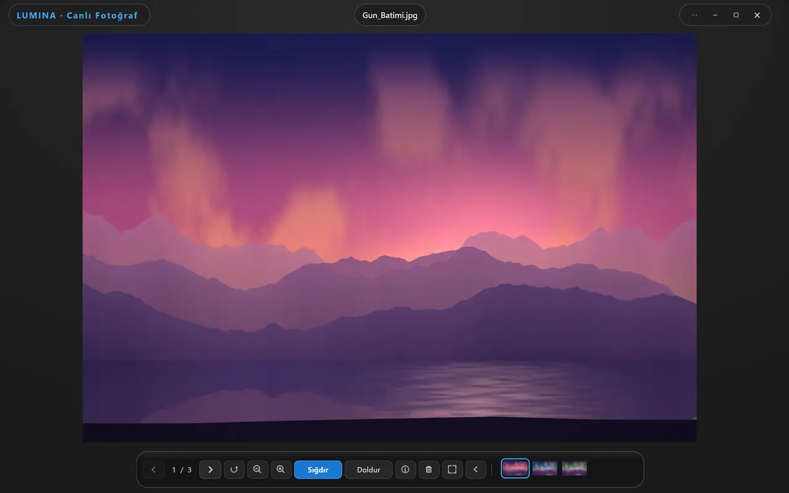
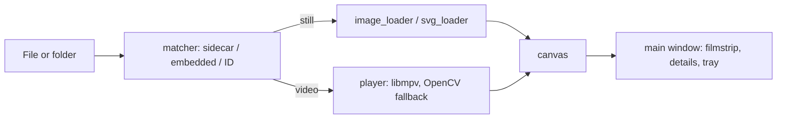

<div align="center">

# Lumina

**A photo and video viewer for Windows that opens Live Photos and Motion Photos as one file.**

English | [Türkçe](README.tr.md)

[](LICENSE)


<picture>
  <source media="(prefers-color-scheme: dark)" srcset="docs/images/lumina-dark.webp">
  <source media="(prefers-color-scheme: light)" srcset="docs/images/lumina-light.webp">
  
</picture>

</div>

Lumina pairs a still photo with its short video (Apple Live Photo, Google or Samsung Motion Photo, `.livp` archives)
and plays it from a "LIVE" button, and it opens most other media types in the same window: HEIC, AVIF, JPEG XL, camera RAW,
SVG, HDR screenshots and common video containers. The interface is a frameless window with a dark, light or system theme.

## Highlights

- **Live Photo and Motion Photo** are matched automatically: embedded videos, `.livp` archives, side-by-side
  `IMG_1234.HEIC` + `IMG_1234.MOV` pairs, and Apple `ContentIdentifier` matching for pairs whose names differ.
- **Many formats in one place**: JPEG, PNG, WebP, GIF, BMP, TIFF, HEIC/HEIF, AVIF, JPEG XL, JPEG 2000, JPEG XR, PSD, SVG/SVGZ
  and a dozen camera RAW formats, plus video containers such as MP4, MOV, MKV, WebM and AVI.
- **Vector-sharp SVG**: the visible region is re-rendered from the vector source as you zoom, in a separate worker process, so the
  interface does not stall.
- **GPU video playback** through libmpv (Direct3D 11 on Windows) with a seek-bar preview frame, audio and subtitle track selection,
  frame stepping, speed control and "resume where I left off" for long videos.
- **Folder browsing** with arrow keys, a filmstrip, a slideshow and live updates when files appear in the folder.
- **Light editing and file operations**: crop, lossless JPEG rotation (EXIF orientation only), rename, save as,
  move or copy to a folder, and delete to the Recycle Bin with undo.
- **Details panel** with file information, EXIF (camera, lens, location), resolution and a histogram.
- **Turkish and English** interface, 10 accent colors, tray icon, and a fast-start launcher written in Rust.

## Features

### Supported formats

| Kind | Extensions |
|---|---|
| Apple / HEIF | `.heic` `.heif` `.hif` `.heics` |
| Modern web formats | `.avif` `.avifs` `.webp` `.jxl` `.jp2` |
| JPEG XR (HDR game and Xbox captures) | `.jxr` `.wdp` `.hdp` (tone-mapped to 8-bit SDR) |
| Common raster | `.jpg` `.jpeg` `.jfif` `.png` `.tif` `.tiff` `.bmp` `.gif` `.ico` `.tga` |
| Camera RAW | `.dng` `.cr2` `.cr3` `.nef` `.nrw` `.arw` `.srf` `.sr2` `.raf` `.rw2` `.orf` `.pef` |
| Layered / vector | `.psd` `.psb` `.svg` `.svgz` |
| Live Photo archive | `.livp` |
| Video | `.mov` `.mp4` `.m4v` `.webm` `.mkv` `.avi` `.ts` `.m2ts` `.mts` `.3gp` `.ogv` `.wmv` `.flv` `.mpeg` `.mpg` |

The exact lists live in [`app/core/matcher.py`](app/core/matcher.py) (`IMAGE_EXTS`, `VIDEO_EXTS`).

### Live Photo and Motion Photo detection

A photo is resolved in this order (see `resolve_live_video` in [`app/core/matcher.py`](app/core/matcher.py)):

| Source | How it is found |
|---|---|
| `.livp` archive | The ZIP is read and its still and video members are used. |
| Samsung Motion Photo | `MotionPhoto_Data` marker / SEFT trailer inside the JPEG. |
| Android / Windows Motion Photo v2 | XMP container directory with the video item length. |
| Google micro-video v1, HEIC `mpvd`, appended MP4 | Offset from the XMP data or an `ftyp` box after the image, verified before use. |
| Side-by-side file | `IMG_1234.MOV`, `.mp4`, `.m4v` or `IMG_1234_HEVC.MOV` / `.mp4` next to the photo (case-insensitive lookup). |
| Apple `ContentIdentifier` | The GUID in the photo is matched to the GUID in a video of the same folder. |

**Settings > Live Photo** has an identity-matching tool that scans a folder and renames videos whose `ContentIdentifier`
matches a photo so that the pair shares a name. It only renames videos and never overwrites an existing file.

### Viewing and navigation

| | |
|---|---|
| Fit / Fill / 1:1 | Fit shows the whole image, Fill covers the window, `1` shows actual pixels. The Fit/Fill choice is remembered. |
| Zoom and pan | Mouse wheel, `+` / `-`, drag to pan; double-click for full screen. |
| Rotate | `R` / `L` or the toolbar button. |
| Folder navigation | Arrow keys or `A` / `D`, `Home` / `End`, filmstrip, four sort orders (name and date, ascending or descending). |
| Slideshow | `F5`; `Esc` stops it. |
| Details panel | `I` or `Alt+Enter`: file info, EXIF, resolution, histogram. |
| Full screen | `F11` or double-click; the interface hides while idle. |
| Multiple windows | Several Lumina windows can be open. |

### Video

| | |
|---|---|
| Playback | libmpv with `vo=gpu` and the Direct3D 11 API on Windows, hardware decoding `auto-safe`. If libmpv is missing or the video output fails, Lumina falls back to OpenCV. |
| Seek preview | A thumbnail of the target frame while hovering the seek bar. |
| Tracks | Audio and subtitle selection (the menu appears only when a file has more than one track); `V` and `B` cycle subtitles and audio. External subtitle files can be opened from the menu. |
| Frame control | `,` / `.` step one frame; `[` `]` (also `<` `>` and `Ctrl+Up` / `Ctrl+Down`) change speed; `Backspace` resets it; `S` saves the current frame as PNG. |
| Loop and resume | `Ctrl+L` loops; for videos longer than 3 minutes the last position is remembered (can be turned off in Settings). |
| Audio output | The output device can be chosen in Settings. |

### Editing and file operations

| | |
|---|---|
| Crop | Drag-able crop frame with a small toolbar. |
| Lossless rotation | For JPEG only the EXIF orientation tag is written, pixels are untouched. PNG, BMP, TIFF and WebP are re-encoded. |
| File actions | Rename (`F2`), Save As (`Ctrl+S`), copy file (`Ctrl+C`), copy image (`Ctrl+Shift+C`), print (`Ctrl+P`), show in Explorer (`Ctrl+E`). |
| Move / copy to folder | Photo and video of a Live Photo pair move together; name clashes get a shared suffix. |
| Delete | `Delete` sends to the Recycle Bin and `Ctrl+Z` undoes it; `Shift+Delete` deletes permanently. |

### Appearance and system

- **Theme**: System, Dark or Light (neutral gray surfaces) and **10 accent colors**; Settings > General.
- **Language**: Turkish, English or automatic.
- **Tray icon**: shown while Lumina runs; click to bring the window forward, right-click for the menu (pending update, Show/Hide,
  Settings, Theme, Language, Open File, Exit). Closing the window (X or `Alt+F4`) or `Ctrl+Q` quits the app, the icon goes with it,
  and nothing keeps running in the background; there is no tray setting. When several Lumina processes run, only one shows the
  icon and another takes over if it exits.
- **System integration (Windows only)**: Settings > General > System Integration adds Lumina to the "Open with" list
  (current user only, no administrator rights, no extra context-menu row) and opens the Windows Default Apps page.

## Installation

### Official build

A ready-to-run `Lumina.exe` is available from **https://macik.com.tr**. It needs no installation and bundles the video decoder
and image codecs.

### From source

Requirements: Windows 10 or later, Python 3.12+, and a libmpv build (see below).

```powershell
git clone https://github.com/Aseloth99/lumina.git
cd lumina
py -3.12 -m venv .venv
.venv\Scripts\activate
pip install -r requirements.txt
```

**libmpv** (`libmpv-2.dll`) is not part of this repository. Download a Windows libmpv build (for example the `mpv-dev` archives
of the Windows builds listed at https://mpv.io/installation/; Lumina is developed against libmpv 0.41) and put `libmpv-2.dll`
into `vendor/mpv/`. Lumina looks
for it in the folder named by the `LUMINA_MPV_DIR` environment variable first, then next to the executable (or in its `vendor/mpv/`),
in `vendor/mpv/` of the checkout, and in `Program Files\mpv`. Without it the app still starts and plays video through the
OpenCV fallback.

Run it:

```powershell
py -3.12 livePhotoViewer.py [file-or-folder]
# or
py -3.12 -m app [file-or-folder]
```

`livePhotoViewer.py` re-launches itself with `pythonw.exe` when no console is attached, so no console window stays open.

## Usage

- Open a file with `Ctrl+O`, a folder with `Ctrl+Shift+O`, drag a file onto the window, pass a path on the command line, or use
  "Open with" after enabling the system integration.
- The "LIVE" button appears only for photos that have a matching video. `Space` plays and pauses.
- Command-line flags used internally by the updater: `--show-window`, `--minimized`, `--wait-pid <pid>`, `--updated <old-version>`.

### Keyboard shortcuts

| Action | Keys |
|---|---|
| Previous / next file | `Left` / `Right`, `A` / `D` (while a video plays, the arrows seek 5 s) |
| Seek 15 s | `Shift+Left` / `Shift+Right` |
| First / last file | `Home` / `End` |
| Play / pause (video, Live Photo) | `Space` |
| Frame step | `,` / `.` or `Ctrl+Left` / `Ctrl+Right` |
| Speed down / up / reset | `[` / `]`, `<` / `>`, `Ctrl+Down` / `Ctrl+Up`; `Backspace` resets |
| Loop | `Ctrl+L` |
| Subtitle / audio track | `V` / `B` |
| Save current frame | `S` |
| Zoom in / out | `+` or `=` / `-` |
| Fit / actual size | `0` or `Ctrl+0` / `1` or `Ctrl+1` |
| Rotate clockwise / counter-clockwise | `R` or `Ctrl+R` / `L` or `Ctrl+Shift+R` |
| Full screen | `F11` (double-click also works); `Esc` leaves |
| Slideshow | `F5` |
| Details panel | `I`, `Ctrl+I` or `Alt+Enter` |
| Rename | `F2` |
| Save as / print | `Ctrl+S` / `Ctrl+P` |
| Copy file / copy image | `Ctrl+C` / `Ctrl+Shift+C` |
| Open file / open folder | `Ctrl+O` / `Ctrl+Shift+O` |
| Show in Explorer | `Ctrl+E` |
| Delete / undo / delete permanently | `Delete` / `Ctrl+Z` / `Shift+Delete` |
| Settings / about / quit | `Ctrl+,` / `F1` / `Ctrl+Q` (`Alt+F4` closes the window) |

### Settings

| Tab | Content |
|---|---|
| **General** | Language, theme (System / Dark / Light), accent color, auto-play of Live Photos, resume videos, audio output device, system integration (Windows). |
| **Live Photo** | Identity matching: renames videos to match their photo by `ContentIdentifier`. |
| **About** | Version, "Check for Updates Automatically", "Install Updates Automatically", manual update check, link to the site. |

Settings are stored with `QSettings` (the Windows registry under `HKCU\Software\Lumina`). Video resume positions are kept in
`%LOCALAPPDATA%\Lumina\resume.json` and a crash log in `%LOCALAPPDATA%\Lumina\logs\crash.log`.

## Updates and notices

Lumina checks `macik.com.tr` for a new version once a day (switch it off in Settings > About). The request carries only the app name and the
current version. When the server provides a SHA-256 checksum, the download is verified before it is installed and a mismatch discards
the package. Background installs happen only for packages that carry a checksum; without one, the update dialog warns and waits for
you to confirm "Install Anyway".

- When a new version exists, an **"Update · vX"** button appears in the title bar. It opens a dialog with version, size and
  release notes and installs in one click, without scripts or console windows; Lumina restarts with the image you had open.
- With "Install Updates Automatically" (on by default, inactive while the automatic check is off) the new version is downloaded in
  the background and installed when you close Lumina.
- If a new version crashes at startup, the previous version is restored and that version is not offered again.
- If the server sends an **announcement**, it is shown as a single line above the window until you dismiss it with the close button.

Installing an update in place works only in the packaged `Lumina.exe` on Windows. On other systems the update dialog offers to open the
download page instead, and running from source cannot install updates.

## Architecture

```
lumina/
├── app/
│   ├── main.py              entry point (QApplication, update boot, window spawn)
│   ├── core/                logic without widgets (most of it has no Qt dependency)
│   │   ├── matcher.py       photo <-> video resolution, folder listing, ID-based merge
│   │   ├── protocols.py     Samsung / Motion Photo v2 / Google v1 / HEIC / .livp offsets
│   │   ├── motion_parser.py embedded MP4 extraction to temp files
│   │   ├── uuid_parser.py   Apple ContentIdentifier reader
│   │   ├── image_loader.py  decoding pipeline (Pillow, pillow-heif, rawpy, imagecodecs, HDR)
│   │   ├── svg_loader.py    SVG base render; svg_region.py / svg_worker.py region re-render in a worker process
│   │   ├── mpv_backend.py   libmpv discovery and loading
│   │   ├── preview_*.py     seek-bar preview frames
│   │   ├── image_edit.py    lossless JPEG rotate, crop, save
│   │   ├── fileops.py       move / copy of file pairs; win_shell.py (Recycle Bin, Explorer)
│   │   ├── updater.py       update check; update_installer.py, self_update.py, update_boot.py
│   │   ├── remote_notice.py server announcement parsing
│   │   └── registry.py      "Open with" registration (HKCU)
│   ├── ui/                  PyQt6 widgets
│   │   ├── main_window.py   main window; media_actions.py mixin for edit / file actions
│   │   ├── canvas.py        QGraphicsView canvas (fit, fill, zoom, pan)
│   │   ├── player.py        libmpv embedding with OpenCV fallback
│   │   ├── filmstrip.py, details_panel.py, settings_dialog.py, update_dialog.py, tray.py ...
│   │   └── message_box.py   custom message boxes used instead of QMessageBox
│   └── resources/           themes, styles, locale strings (tr / en), icon
├── launcher/                Rust fast-start launcher (cargo project)
├── scripts/                 build_fast_exe.py, smoke_exe.py
├── tests/                   unittest suite (synthetic media, no binary fixtures)
├── vendor/mpv/              put libmpv-2.dll here (not in the repository)
├── lumina.spec              PyInstaller spec
└── livePhotoViewer.py       convenience launcher for running from source
```



The Rust launcher (`launcher/`) exists for start-up time: a one-folder PyInstaller build is zipped and appended to a small
executable, which unpacks it once per version under `%LOCALAPPDATA%\Lumina\runtime\<key>\` and starts the app from there instead of
unpacking several hundred MB on every launch.

## Building

```powershell
pip install -r requirements-dev.txt

# Fast-start executable: PyInstaller one-folder build + Rust launcher -> dist\Lumina.exe and dist\Lumina.zip
# (needs libmpv-2.dll in vendor\mpv and the Rust toolchain; the first build downloads the crates of the launcher)
py -3.12 scripts/build_fast_exe.py

# Or a plain single-file executable without the launcher
py -3.12 -m PyInstaller --noconfirm --clean lumina.spec
```

`lumina.spec` stops with an error when `vendor/mpv/libmpv-2.dll` or `resvg_py` is missing. `scripts/smoke_exe.py [exe] [file]` starts a
built executable on a hidden desktop with isolated settings and checks that the window opens and exits cleanly.

## Tests

```powershell
$env:QT_QPA_PLATFORM = "offscreen"
py -3.12 -X utf8 -m unittest discover -s tests
```

The suite uses generated media only: `tests/_synthetic.py` writes a JPEG and a HEIC + MOV pair into a temporary folder, and
other tests encode small videos with OpenCV. Tests that exercise libmpv need `libmpv-2.dll` (see above; set `LUMINA_MPV_DIR` to its
folder). Registry tests run against a throw-away subtree of `HKCU`. The Rust launcher has its own tests: `cargo test` inside `launcher/`.

## Platform support

Windows is the primary and only regularly used platform. The macOS and Linux code paths (user directories, libmpv lookup, font choice,
X11 preference under Wayland, case-insensitive file lookup) have unit tests, but the application has not been run on those systems and
should be considered experimental there.

## Third-party software and licenses

The source code of this repository is released under the [MIT License](LICENSE). Lumina depends on software with its own terms:

- **PyQt6** is available under GPL-3.0 or a commercial license (Qt itself under LGPL-3.0 and others). The source code here is MIT, but
  when you distribute a binary that includes PyQt6 the license terms of PyQt6 apply.
- **libmpv**: the `libmpv-2.dll` used for the official binaries reports itself as distributed under the GNU GPL version 2 or later. mpv
  can also be built under LGPL 2.1 or later; check the terms of the build you bundle. `python-mpv` is GPL-2.0-or-later or LGPL-2.1-or-later.
- **resvg-py** (MIT; it wraps `resvg`, Apache-2.0 or MIT) renders SVG.
- Pillow, pillow-heif, pillow-avif-plugin, rawpy, imagecodecs, OpenCV and NumPy are used under their own licenses, and their wheels
  bundle native libraries (for example libheif, LibRaw and FFmpeg) with theirs. PyInstaller is used for builds.

## License

[MIT](LICENSE) © 2026 Mustafa Açık
