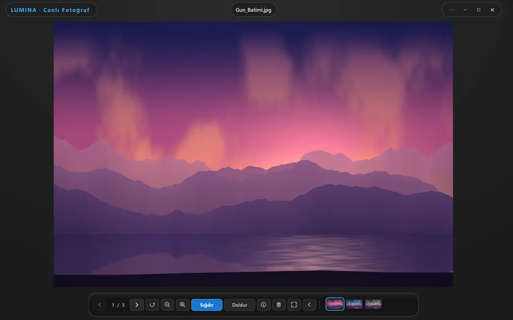
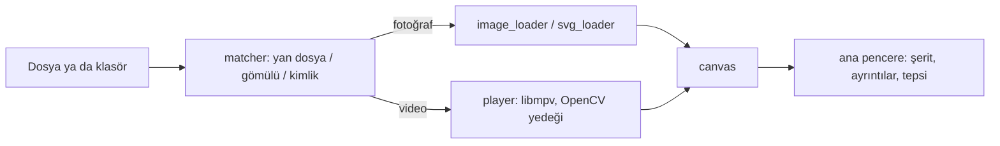

<div align="center">

# Lumina

**Canlı Fotoğrafları ve Hareketli Fotoğrafları tek dosya gibi açan, Windows için fotoğraf ve video görüntüleyici.**

[English](README.md) | Türkçe

[](LICENSE)


<picture>
  <source media="(prefers-color-scheme: dark)" srcset="docs/images/lumina-dark.webp">
  <source media="(prefers-color-scheme: light)" srcset="docs/images/lumina-light.webp">
  
</picture>

</div>

Lumina, bir fotoğrafı kısa videosuyla eşleştirir (Apple Canlı Fotoğraf, Google ya da Samsung Hareketli Fotoğraf, `.livp` arşivleri)
ve "CANLI" düğmesinden oynatır. Bunun dışındaki çoğu medya türünü de aynı pencerede açar: HEIC, AVIF, JPEG XL, kamera RAW,
SVG, HDR ekran görüntüleri ve yaygın video kapsayıcıları. Arayüz, koyu, açık ya da sistem temalı çerçevesiz bir penceredir.

## Öne Çıkanlar

- **Canlı Fotoğraf ve Hareketli Fotoğraf** kendiliğinden eşleşir: gömülü videolar, `.livp` arşivleri, yan yana duran
  `IMG_1234.HEIC` + `IMG_1234.MOV` çiftleri ve adları farklı olan çiftler için Apple `ContentIdentifier` eşleştirmesi.
- **Tek yerde çok biçim**: JPEG, PNG, WebP, GIF, BMP, TIFF, HEIC/HEIF, AVIF, JPEG XL, JPEG 2000, JPEG XR, PSD, SVG/SVGZ ve
  bir düzine kamera RAW biçimi; ayrıca MP4, MOV, MKV, WebM, AVI gibi video kapsayıcıları.
- **Vektörden keskin SVG**: yakınlaştırdıkça görünen bölge, ayrı bir işçi süreçte vektör kaynaktan yeniden çizilir; arayüz donmaz.
- libmpv ile **GPU hızlandırmalı video** (Windows'ta Direct3D 11): kaydırma çubuğunda önizleme karesi, ses ve altyazı parçası seçimi,
  kare kare ilerleme, hız ayarı ve uzun videolarda "kaldığınız yerden devam".
- **Klasörde gezinme**: ok tuşları, küçük resim şeridi, slayt gösterisi ve klasörde dosya belirince otomatik güncelleme.
- **Hafif düzenleme ve dosya işleri**: kırpma, JPEG'de kayıpsız döndürme (yalnızca EXIF yönü), yeniden adlandırma, farklı kaydetme,
  klasöre taşıma/kopyalama ve geri alınabilir Geri Dönüşüm Kutusu silmesi.
- **Ayrıntılar paneli**: dosya bilgisi, EXIF (kamera, lens, konum), çözünürlük ve histogram.
- **Türkçe ve İngilizce** arayüz, 10 vurgu rengi, sistem tepsisi simgesi ve Rust ile yazılmış hızlı açılış başlatıcısı.

## Özellikler

### Desteklenen Biçimler

| Tür | Uzantılar |
|---|---|
| Apple / HEIF | `.heic` `.heif` `.hif` `.heics` |
| Modern web biçimleri | `.avif` `.avifs` `.webp` `.jxl` `.jp2` |
| JPEG XR (HDR oyun ve Xbox görüntüleri) | `.jxr` `.wdp` `.hdp` (8 bit SDR'ye ton eşlenir) |
| Yaygın piksel biçimleri | `.jpg` `.jpeg` `.jfif` `.png` `.tif` `.tiff` `.bmp` `.gif` `.ico` `.tga` |
| Kamera RAW | `.dng` `.cr2` `.cr3` `.nef` `.nrw` `.arw` `.srf` `.sr2` `.raf` `.rw2` `.orf` `.pef` |
| Katmanlı / vektör | `.psd` `.psb` `.svg` `.svgz` |
| Canlı Fotoğraf arşivi | `.livp` |
| Video | `.mov` `.mp4` `.m4v` `.webm` `.mkv` `.avi` `.ts` `.m2ts` `.mts` `.3gp` `.ogv` `.wmv` `.flv` `.mpeg` `.mpg` |

Kesin listeler [`app/core/matcher.py`](app/core/matcher.py) içinde (`IMAGE_EXTS`, `VIDEO_EXTS`).

### Canlı Fotoğraf ve Hareketli Fotoğraf Eşleştirme

Bir fotoğraf şu sırayla çözülür (bkz. [`app/core/matcher.py`](app/core/matcher.py) içindeki `resolve_live_video`):

| Kaynak | Nasıl bulunur |
|---|---|
| `.livp` arşivi | ZIP okunur, içindeki fotoğraf ve video kullanılır. |
| Samsung Hareketli Fotoğraf | JPEG içindeki `MotionPhoto_Data` işareti / SEFT kuyruğu. |
| Android / Windows Hareketli Fotoğraf v2 | Video öğesinin uzunluğunu veren XMP kapsayıcı dizini. |
| Google mikro video v1, HEIC `mpvd`, eklenmiş MP4 | XMP'deki ofset ya da görüntünün ardındaki `ftyp` kutusu; kullanılmadan önce doğrulanır. |
| Yan yana dosya | Fotoğrafın yanındaki `IMG_1234.MOV`, `.mp4`, `.m4v` ya da `IMG_1234_HEVC.MOV` / `.mp4` (harf büyüklüğü fark etmez). |
| Apple `ContentIdentifier` | Fotoğraftaki GUID, aynı klasördeki bir videonun GUID'iyle eşleştirilir. |

**Ayarlar > Canlı Fotoğraf** sekmesindeki kimlik eşleştirme aracı bir klasörü tarar ve `ContentIdentifier` değeri bir fotoğrafla
eşleşen videoları, çift aynı adı taşısın diye yeniden adlandırır. Yalnızca videoları yeniden adlandırır, var olan hiçbir dosyanın üzerine yazmaz.

### Görüntüleme ve Gezinme

| | |
|---|---|
| Sığdır / Doldur / 1:1 | Sığdır görüntünün tamamını gösterir, Doldur pencereyi kaplar, `1` gerçek pikselleri gösterir. Sığdır/Doldur seçimi hatırlanır. |
| Yakınlaştırma ve kaydırma | Fare tekerleği, `+` / `-`, sürükleyerek kaydırma; çift tıklama tam ekrandır. |
| Döndürme | `R` / `L` ya da araç çubuğu düğmesi. |
| Klasörde gezinme | Ok tuşları ya da `A` / `D`, `Home` / `End`, küçük resim şeridi, dört sıralama (ad ve tarih, artan ya da azalan). |
| Slayt gösterisi | `F5`; `Esc` durdurur. |
| Ayrıntılar paneli | `I` ya da `Alt+Enter`: dosya bilgisi, EXIF, çözünürlük, histogram. |
| Tam ekran | `F11` ya da çift tıklama; boştayken arayüz gizlenir. |
| Birden çok pencere | Birden çok Lumina penceresi açık olabilir. |

### Video

| | |
|---|---|
| Oynatma | Windows'ta `vo=gpu` ve Direct3D 11 ile libmpv, donanım çözümü `auto-safe`. libmpv yoksa ya da video çıkışı kurulamazsa Lumina OpenCV yedeğine düşer. |
| Kaydırma önizlemesi | Kaydırma çubuğunun üzerine gelince hedef karenin küçük resmi. |
| Parçalar | Ses ve altyazı seçimi (menü yalnızca dosyada birden fazla parça varsa görünür); `V` ve `B` altyazıyı ve sesi döngüyle değiştirir. Dış altyazı dosyaları menüden açılabilir. |
| Kare ve hız | `,` / `.` bir kare ilerletir/geri alır; `[` `]` (ayrıca `<` `>` ve `Ctrl+Yukarı` / `Ctrl+Aşağı`) hızı değiştirir; `Backspace` sıfırlar; `S` geçerli kareyi PNG olarak kaydeder. |
| Döngü ve devam | `Ctrl+L` döngüyü açar; 3 dakikadan uzun videolarda son konum hatırlanır (Ayarlar'dan kapatılabilir). |
| Ses çıkışı | Çıkış aygıtı Ayarlar'dan seçilir. |

### Düzenleme ve Dosya İşleri

| | |
|---|---|
| Kırpma | Sürüklenebilir kırpma çerçevesi ve küçük bir araç çubuğu. |
| Kayıpsız döndürme | JPEG'de yalnızca EXIF yön etiketi yazılır, piksellere dokunulmaz. PNG, BMP, TIFF ve WebP yeniden kodlanır. |
| Dosya işleri | Yeniden Adlandır (`F2`), Farklı Kaydet (`Ctrl+S`), dosyayı kopyala (`Ctrl+C`), görüntüyü kopyala (`Ctrl+Shift+C`), yazdır (`Ctrl+P`), Klasörde Göster (`Ctrl+E`). |
| Klasöre taşı / kopyala | Canlı Fotoğraf çiftinin fotoğrafı ve videosu birlikte taşınır; ad çakışmasında ortak sonek eklenir. |
| Silme | `Delete` dosyayı Geri Dönüşüm Kutusu'na gönderir, `Ctrl+Z` geri alır; `Shift+Delete` kalıcı siler. |

### Görünüm ve Sistem

- **Tema**: Sistem, Koyu ya da Açık (nötr gri yüzeyler) ve **10 vurgu rengi**; Ayarlar > Genel.
- **Dil**: Türkçe, İngilizce ya da otomatik.
- **Tepsi simgesi**: Lumina çalışırken görünür; tek tıkla pencere öne gelir, sağ tıkla menü açılır (bekleyen güncelleme,
  Göster/Gizle, Ayarlar, Tema, Dil, Dosya Aç, Çıkış). Pencereyi kapatmak (X ya da `Alt+F4`) veya `Ctrl+Q` uygulamayı kapatır, simge de
  gider ve arka planda hiçbir şey çalışmaz; tepsi ayarı yoktur. Birden çok Lumina süreci çalışıyorsa simgeyi yalnızca biri
  gösterir; o kapanırsa simgeyi bir başkası devralır.
- **Sistem entegrasyonu (yalnızca Windows)**: Ayarlar > Genel > Sistem Entegrasyonu, Lumina'yı "Birlikte Aç" listesine ekler
  (yalnızca geçerli kullanıcı için, yönetici hakkı gerekmez, sağ tık menüsüne ayrı bir satır eklemez) ve Windows'un Varsayılan Uygulamalar sayfasını açar.

## Kurulum

### Resmî Sürüm

Çalıştırmaya hazır `Lumina.exe`, **https://macik.com.tr** adresinde. Kurulum gerektirmez; video çözücüyü ve görüntü kodeklerini içerir.

### Kaynaktan

Gereksinimler: Windows 10 ya da üstü, Python 3.12+ ve bir libmpv derlemesi (aşağıya bakın).

```powershell
git clone https://github.com/Aseloth99/lumina.git
cd lumina
py -3.12 -m venv .venv
.venv\Scripts\activate
pip install -r requirements.txt
```

**libmpv** (`libmpv-2.dll`) bu depoda yoktur. Bir Windows libmpv derlemesi indirin (örneğin https://mpv.io/installation/ sayfasında
listelenen Windows derlemelerinin `mpv-dev` arşivleri; Lumina libmpv 0.41 ile geliştirilmiştir) ve `libmpv-2.dll` dosyasını
`vendor/mpv/` içine koyun. Lumina onu önce `LUMINA_MPV_DIR` ortam değişkeninin gösterdiği klasörde, sonra çalıştırılabilir dosyanın
yanında (ya da onun `vendor/mpv/` klasöründe), deponun `vendor/mpv/` klasöründe ve `Program Files\mpv` içinde arar.
Dosya yoksa uygulama yine açılır ve videoyu OpenCV yedeğiyle oynatır.

Çalıştırma:

```powershell
py -3.12 livePhotoViewer.py [dosya-ya-da-klasör]
# ya da
py -3.12 -m app [dosya-ya-da-klasör]
```

`livePhotoViewer.py`, bir konsol bağlı değilse kendini `pythonw.exe` ile yeniden başlatır; böylece açık bir konsol penceresi kalmaz.

## Kullanım

- `Ctrl+O` ile dosya, `Ctrl+Shift+O` ile klasör açın; dosyayı pencereye sürükleyin, komut satırında yol verin ya da sistem
  entegrasyonunu açtıktan sonra "Birlikte Aç"ı kullanın.
- "CANLI" düğmesi yalnızca eşleşen videosu olan fotoğraflarda görünür. `Space` oynatır ve duraklatır.
- Güncelleyicinin dahili olarak kullandığı komut satırı bayrakları: `--show-window`, `--minimized`, `--wait-pid <pid>`, `--updated <eski-sürüm>`.

### Klavye Kısayolları

| İşlem | Tuşlar |
|---|---|
| Önceki / sonraki dosya | `Sol` / `Sağ`, `A` / `D` (video oynarken oklar 5 sn atlar) |
| 15 sn atla | `Shift+Sol` / `Shift+Sağ` |
| İlk / son dosya | `Home` / `End` |
| Oynat / duraklat (video, Canlı Fotoğraf) | `Space` |
| Kare kare ilerle | `,` / `.` ya da `Ctrl+Sol` / `Ctrl+Sağ` |
| Hızı azalt / artır / sıfırla | `[` / `]`, `<` / `>`, `Ctrl+Aşağı` / `Ctrl+Yukarı`; `Backspace` sıfırlar |
| Döngü | `Ctrl+L` |
| Altyazı / ses parçası | `V` / `B` |
| Geçerli kareyi kaydet | `S` |
| Yakınlaştır / uzaklaştır | `+` ya da `=` / `-` |
| Sığdır / gerçek boyut | `0` ya da `Ctrl+0` / `1` ya da `Ctrl+1` |
| Saat yönünde / tersine döndür | `R` ya da `Ctrl+R` / `L` ya da `Ctrl+Shift+R` |
| Tam ekran | `F11` (çift tıklama da çalışır); `Esc` çıkarır |
| Slayt gösterisi | `F5` |
| Ayrıntılar paneli | `I`, `Ctrl+I` ya da `Alt+Enter` |
| Yeniden Adlandır | `F2` |
| Farklı kaydet / yazdır | `Ctrl+S` / `Ctrl+P` |
| Dosyayı kopyala / görüntüyü kopyala | `Ctrl+C` / `Ctrl+Shift+C` |
| Dosya aç / klasör aç | `Ctrl+O` / `Ctrl+Shift+O` |
| Klasörde Göster | `Ctrl+E` |
| Sil / geri al / kalıcı sil | `Delete` / `Ctrl+Z` / `Shift+Delete` |
| Ayarlar / hakkında / çıkış | `Ctrl+,` / `F1` / `Ctrl+Q` (`Alt+F4` pencereyi kapatır) |

### Ayarlar

| Sekme | İçerik |
|---|---|
| **Genel** | Dil, tema (Sistem / Koyu / Açık), vurgu rengi, Canlı Fotoğrafları otomatik oynatma, videoda kaldığınız yerden devam, ses çıkış aygıtı, sistem entegrasyonu (Windows). |
| **Canlı Fotoğraf** | Kimlik eşleştirme: videoları `ContentIdentifier` değerine göre fotoğraflarının adıyla yeniden adlandırır. |
| **Hakkında** | Sürüm, "Güncellemeleri Otomatik Kontrol Et", "Güncellemeleri Otomatik Kur", elle güncelleme denetimi, site bağlantısı. |

Ayarlar `QSettings` ile saklanır (Windows kayıt defterinde `HKCU\Software\Lumina`). Video devam konumları
`%LOCALAPPDATA%\Lumina\resume.json` dosyasında, çökme günlüğü `%LOCALAPPDATA%\Lumina\logs\crash.log` dosyasındadır.

## Güncelleme ve Duyurular

Lumina günde bir kez macik.com.tr üzerinden yeni sürümü denetler (Ayarlar > Hakkında'dan kapatılır). İstek yalnızca uygulama adını ve
mevcut sürümü taşır. Sunucu bir SHA-256 sağlama toplamı verirse indirme kurulmadan önce doğrulanır; uyuşmazlıkta paket atılır. Arka
planda kurulum yalnızca sağlama toplamı olan paketlerde yapılır; sağlama toplamı yoksa güncelleme penceresi uyarır ve "Yine de Kur"
onayınızı bekler.

- Yeni sürüm varsa başlık çubuğunda **"Güncelle · vX"** düğmesi çıkar. Sürümü, boyutu ve sürüm notlarını gösteren pencereyi açar; tek
  tıkla, betik ya da konsol penceresi olmadan kurar ve Lumina açık görüntünüzle yeniden başlar.
- "Güncellemeleri Otomatik Kur" açıksa (varsayılan; otomatik denetim kapalıyken pasif) yeni sürüm arka planda indirilir ve Lumina'yı
  kapattığınızda kurulur.
- Yeni sürüm açılışta çökerse bir önceki sürüm geri gelir ve o sürüm bir daha önerilmez.
- Sunucu bir **duyuru** gönderirse pencerenin üstünde tek satır olarak görünür ve kapatma düğmesiyle kapatana dek kalır.

Güncellemeyi yerinde kurma yalnızca Windows'ta paketlenmiş `Lumina.exe` içinde çalışır. Diğer sistemlerde güncelleme penceresi bunun yerine
indirme sayfasını açmayı önerir; kaynaktan çalışırken güncelleme kurulamaz.

## Mimari

```
lumina/
├── app/
│   ├── main.py              giriş noktası (QApplication, güncelleme önyüklemesi, pencere)
│   ├── core/                pencere öğesi içermeyen mantık (çoğunda Qt bağımlılığı yok)
│   │   ├── matcher.py       fotoğraf <-> video çözümü, klasör listesi, kimlikle birleştirme
│   │   ├── protocols.py     Samsung / Hareketli Fotoğraf v2 / Google v1 / HEIC / .livp ofsetleri
│   │   ├── motion_parser.py gömülü MP4'ü geçici dosyaya çıkarma
│   │   ├── uuid_parser.py   Apple ContentIdentifier okuyucu
│   │   ├── image_loader.py  çözme hattı (Pillow, pillow-heif, rawpy, imagecodecs, HDR)
│   │   ├── svg_loader.py    SVG taban çizimi; svg_region.py / svg_worker.py bölgeyi işçi süreçte yeniden çizer
│   │   ├── mpv_backend.py   libmpv arama ve yükleme
│   │   ├── preview_*.py     kaydırma çubuğu önizleme kareleri
│   │   ├── image_edit.py    kayıpsız JPEG döndürme, kırpma, kaydetme
│   │   ├── fileops.py       dosya çiftlerini taşıma / kopyalama; win_shell.py (Geri Dönüşüm Kutusu, Gezgin)
│   │   ├── updater.py       güncelleme denetimi; update_installer.py, self_update.py, update_boot.py
│   │   ├── remote_notice.py sunucu duyurusunu ayrıştırma
│   │   └── registry.py      "Birlikte Aç" kaydı (HKCU)
│   ├── ui/                  PyQt6 arayüzü
│   │   ├── main_window.py   ana pencere; media_actions.py düzenleme / dosya eylemleri karışımı
│   │   ├── canvas.py        QGraphicsView tuvali (sığdır, doldur, yakınlaştır, kaydır)
│   │   ├── player.py        libmpv gömme, OpenCV yedeği
│   │   ├── filmstrip.py, details_panel.py, settings_dialog.py, update_dialog.py, tray.py ...
│   │   └── message_box.py   QMessageBox yerine kullanılan özel mesaj kutuları
│   └── resources/           temalar, stiller, dil dizgileri (tr / en), simge
├── launcher/                Rust hızlı açılış başlatıcısı (cargo projesi)
├── scripts/                 build_fast_exe.py, smoke_exe.py
├── tests/                   unittest takımı (sentetik medya, ikili test dosyası yok)
├── vendor/mpv/              libmpv-2.dll buraya konur (depoda yok)
├── lumina.spec              PyInstaller tanımı
└── livePhotoViewer.py       kaynaktan çalıştırmak için kolay başlatıcı
```



Rust başlatıcı (`launcher/`) açılış süresi içindir: tek klasörlük bir PyInstaller çıktısı zip'lenip küçük bir çalıştırılabilir dosyanın
sonuna eklenir; başlatıcı bunu sürüm başına bir kez `%LOCALAPPDATA%\Lumina\runtime\<anahtar>\` altına açar ve uygulamayı oradan
başlatır. Böylece her açılışta yüzlerce MB açılmaz.

## Derleme

```powershell
pip install -r requirements-dev.txt

# Hızlı açılan exe: PyInstaller klasör derlemesi + Rust başlatıcı -> dist\Lumina.exe ve dist\Lumina.zip
# (vendor\mpv içinde libmpv-2.dll ve Rust araç zinciri gerekir; ilk derlemede başlatıcının kasaları indirilir)
py -3.12 scripts/build_fast_exe.py

# Ya da başlatıcısız, tek dosyalık exe
py -3.12 -m PyInstaller --noconfirm --clean lumina.spec
```

`lumina.spec`, `vendor/mpv/libmpv-2.dll` ya da `resvg_py` eksikse hata vererek durur. `scripts/smoke_exe.py [exe] [dosya]`, derlenmiş exe'yi
görünmeyen bir masaüstünde, yalıtılmış ayarlarla başlatır; pencerenin açıldığını ve temiz kapandığını denetler.

## Testler

```powershell
$env:QT_QPA_PLATFORM = "offscreen"
py -3.12 -X utf8 -m unittest discover -s tests
```

Takım yalnızca üretilmiş medya kullanır: `tests/_synthetic.py` geçici bir klasöre bir JPEG ve bir HEIC + MOV çifti yazar; diğer testler
OpenCV ile küçük videolar kodlar. libmpv'yi deneyen testler `libmpv-2.dll` ister (yukarıya bakın; klasörünü `LUMINA_MPV_DIR` ile gösterin).
Kayıt defteri testleri `HKCU` altında geçici bir alt ağaçta çalışır. Rust başlatıcının kendi testleri vardır: `launcher/` içinde `cargo test`.

## Platform Desteği

Windows, birincil ve düzenli olarak kullanılan tek platformdur. macOS ve Linux kod yolları (kullanıcı dizinleri, libmpv arama, yazı tipi
seçimi, Wayland altında X11 tercihi, harf duyarsız dosya arama) birim testlidir, ancak uygulama o sistemlerde çalıştırılmamıştır;
orada deneysel sayılmalıdır.

## Üçüncü Taraf Yazılımlar ve Lisanslar

Bu depodaki kaynak kod [MIT Lisansı](LICENSE) ile yayımlanır. Lumina, kendi koşulları olan yazılımlara dayanır:

- **PyQt6**, GPL-3.0 ya da ticari lisansla sunulur (Qt'nin kendisi LGPL-3.0 ve diğer lisanslarla). Buradaki kaynak kod MIT'tir; ancak PyQt6
  içeren bir ikili dağıtırken PyQt6'nın lisans koşulları geçerlidir.
- **libmpv**: resmî ikililerde kullanılan `libmpv-2.dll`, dosya bilgisinde GNU GPL sürüm 2 ya da üstü ile dağıtıldığını bildirir. mpv
  LGPL 2.1 ya da üstü olarak da derlenebilir; gömdüğünüz derlemenin koşullarına bakın. `python-mpv`, GPL-2.0-or-later ya da LGPL-2.1-or-later'dır.
- **resvg-py** (MIT; `resvg` sarmalar, Apache-2.0 ya da MIT) SVG çizer.
- Pillow, pillow-heif, pillow-avif-plugin, rawpy, imagecodecs, OpenCV ve NumPy kendi lisanslarıyla kullanılır; tekerlekleri kendi
  koşulları olan yerel kütüphaneleri (örneğin libheif, LibRaw ve FFmpeg) içerir. Derlemelerde PyInstaller kullanılır.

## Lisans

[MIT](LICENSE) © 2026 Mustafa Açık
